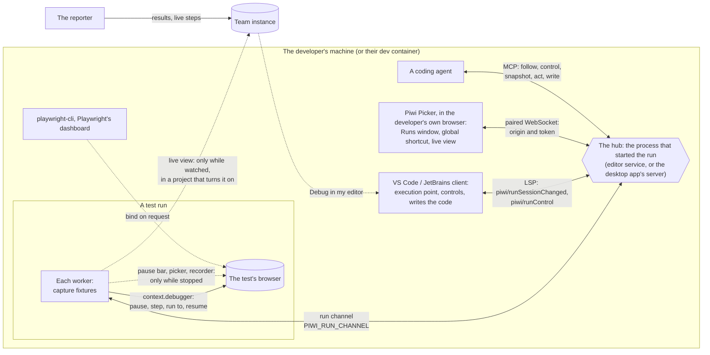

# Run control from Piwi Picker and the editor

A plan to steer a running Playwright test from outside it: pause it now, step it, run it to a line, resume it, and
write code from where it stands, from Piwi Picker (the browser extension), from the IDE, from the page itself and from
the desktop app. The question was whether the browser extension could control a test run Playwright started, whether
that means loading the extension into the browser Playwright drives, and whether the code made there could land in
the IDE plugin. It can; the extension does not need to be in that browser, and should not be; and the code lands in
the IDE through the paths that already exist. Since Playwright 1.59, pausing, stepping and resuming a test is public
API (`browserContext.debugger`), which every Piwi user has: the reporter requires `@playwright/test` 1.64.1. A spike
paused a running test from an extension page in a second browser, held it for 4.5 s, longer than its 4 s timeout,
stepped it and let it pass. The same session reaches the dashboard, as a live view to watch, and coding agents, as
tools that follow the run, read the stopped page as its accessibility tree and act on it.

**Status.** Proposed 2026-10-24. Nothing is built. The spikes in the [appendix](#appendix-the-spikes) are the evidence
for the feasibility claims; they are not part of the repository. Nothing here is on [`ROADMAP.md`](../ROADMAP.md) yet.
The contracts it would add are entry D60 of [`1.0-stabilization.md`](1.0-stabilization.md).

**Summary.** Piwi already pauses a run the editor starts at the editor's breakpoints, with a bar in the page that picks
a locator for that line or records the steps that come next ([`editor-local-runs.md`](../adr/editor-local-runs.md),
[`record-from-the-ide.md`](record-from-the-ide.md)). That pause is set before the run, on locator actions only, in
headed runs only, and only the page knows it is paused. This plan makes the pause a shared, live state every Piwi
surface can see and change:

- **Pause a running test now**, before its next Playwright call that acts on or checks the page (a navigation, a
  click, a key press, an assertion), from the IDE, from Piwi Picker, or, in Chrome and Edge, with a keyboard shortcut
  that works while the test's window has focus.
- **Step, run to the caret, resume**, and add or remove breakpoints while the run goes on.
- **See where it stands**: the paused line as the execution point in the editor, the paused page in Piwi Picker's
  window, headless runs and runs in a dev container included.
- **Write code from there**: a locator, recorded steps, an assertion (an ARIA snapshot of a region among them), a
  mock of a request the page made, all rendered by the editor service and written at the paused line by the IDE.
- **From the developer's own browser**: Chrome, Edge or Firefox, with nothing of Piwi in the browser the test drives.
- **The same for the desktop app's runs** (reproduce, bisect, Flake Lab, bug reports), and a failure page in the
  dashboard that opens the test in the editor, paused at the failing line.
- **Watch a run from the dashboard**: a live view of each worker's page beside the step it is on, for the runs the
  desktop app starts and, in a project that turns it on, for CI runs on the team instance, which can only watch.
- **Hand a run to a coding agent**: the same session as tools, so an agent can follow the run, stop it, read the
  stopped page as its accessibility tree, act on it as a person would, and write the code through the IDE.

Of the four things [`ROADMAP.md`](../ROADMAP.md) says Piwi is for, this serves the third, **hand back a fix**: the
locator, the missing steps or the assertion are made on the live page, at the place the test stopped or failed, and
land in the code there. It reaches the second through **Debug in my editor** from a failure cluster. It is a delivery
route, like the editor extensions it extends.

## The short answer

The question assumed the extension would have to be loaded into the browser Playwright launches. There are three
places Piwi's controls can live, and that one is the weakest:

| Where the controls live | What it takes | Verdict |
| --- | --- | --- |
| **Piwi Picker inside the test's browser** (`--load-extension`) | Playwright's bundled Chromium only: Google Chrome and Microsoft Edge removed the flag ([from Chrome 137](https://groups.google.com/a/chromium.org/g/chromium-extensions/c/1-g8EFx2BBY)). A persistent context only (`launchPersistentContext`): one profile per worker or per test, no `storageState` option, so a suite that signs in through `use.storageState` loses its sign-in, and a context the test makes with `browser.newContext()` gets no extension. Firefox and WebKit cannot load it. | No. It changes how the suite runs to add controls Piwi already injects while paused. [`record-from-the-ide.md`](record-from-the-ide.md) D1 reached the same conclusion for recording. |
| **Piwi Picker in the developer's own browser, as a remote control** | A local hub (the process that started the run) and a paired WebSocket. | Yes. One extension controls a run whatever browser it drives, headed or headless (Chromium in spike C, the pause itself in Firefox in spike A, WebKit unverified), and is never in the test's page, its screenshots or its accessibility tree. |
| **In the page, while paused** (the pause bar, the picker, the recorder) | Scripts injected through Playwright while the test waits. | Yes, as today, and only while paused (D7). |

The browser extension is the right place for a **Pause** button: while the test acts, nothing of Piwi may be in its
page, and the IDE is often behind the test's window. A small Piwi Picker window beside it, or a global shortcut,
reaches the run without touching the page.

## How the pieces connect



Four channels are new: the run channel between each worker and the hub (Part 2), the session between the hub and the
IDE clients over the protocol they already speak (Part 3), a WebSocket between the hub and Piwi Picker (Part 4), and
the hub's tools for agents (Part 9). One more is optional: the frames a worker sends the team instance while someone
watches (Part 8). What exists keeps its job: the reporter sends results and live steps to the instance, Send to editor
still takes a locator or a recording from Piwi Picker to the editor, and the desktop app's pairing still carries bug
reports. Control comes only from the developer's own surfaces: on the machine, or from their browser through the
address their IDE forwards to a dev container.

## What the reader gets

In WebStorm, `tests/checkout.spec.ts`, **Run this test** above `test('pays with a coupon')`. Chromium opens; the test
signs in from the project's `storageState` and fills the cart. Beside it, the Piwi Picker window (opened once from the
toolbar popup's **Runs**) follows the run:

```
Piwi · checkout.spec.ts › pays with a coupon · chromium · attempt 1
● Running · Click getByRole('link', { name: 'Checkout' })            Pause
```

The coupon field looks wrong. **Pause** in that window, or Ctrl+Shift+5 from any window (a Chrome shortcut): the test
stops before its next Playwright call, here a fill in a page object.

```
checkout.page.ts                                                       ← opened by the editor at the paused line
 29     async applyCoupon(code: string) {
 30 ▶     await this.page.getByLabel('Coupon').fill(code);              ← the execution point
        ⏸ Paused · Fill "WELCOME10" getByLabel('Coupon') · Resume · Step · Run to Cursor · Pick · Record · Assert
 31       await this.page.getByRole('button', { name: 'Apply' }).click();
```

The test's page shows Piwi's pause bar; the Piwi Picker window shows the same place, an image of the page and the
same buttons. **Pick** in either and click the field: `getByLabel('Coupon')` on line 30 becomes
`getByRole('textbox', { name: 'Coupon code' })`, the locator the picker verified finds that field alone. **Run to
Cursor** with the caret on line 42 of the spec: the test runs on and stops there. **Assert a region**, then the order summary:

```ts
await expect(page.getByRole('region', { name: 'Order summary' })).toMatchAriaSnapshot(`
  - heading "Order summary" [level=2]
  - text: Red shoes €80.00 Coupon WELCOME10 −€8.00
  - text: Total €72.00
`);
```

is written above line 42, read from the paused page. **Resume**: the test passes. The run reaches the instance as an
interactive run: its results count, its paused calls stay out of the timing figures.

The same test in a dev container, headless: the run still pauses, the editor still shows the execution point, and the
Piwi Picker window shows a live view of the page in place of a window nobody can see. **Pick** and **Record** work on
that view; the steps land in the editor as before.

The developer then asks the IDE's coding agent to finish the test. The agent follows the run, stops it at the test's
last line, reads the page as its accessibility tree, clicks **Place order** by its ref and checks the confirmation
heading. Each of its actions is recorded as a step, shows in the Piwi Picker window as it happens, and the steps are
written above the last line as an edit to keep or undo.

On the team instance, a teammate opens a CI run that is still running, sees worker 3 on the same payment step for a
minute, and clicks **Watch**: the worker's page appears beside its step, a spinner that never ends. They can watch, not
steer.

This is the end state of the [Delivery](#delivery). The first release (PRs 1 and 2) has Pause, Step, Run to Cursor and
Resume in both IDEs, on top of today's pause bar.

## What exists

| Piece | Where | What it gives this plan |
| --- | --- | --- |
| Breakpoints in the browser | `packages/reporter/src/internal/capture/pause-at.ts`, `capture-fixtures.ts` (`pausesAt`, `pauseBefore`, `pauseInPlace`), [`editor-local-runs.md`](../adr/editor-local-runs.md) Part 4 | `PIWI_PAUSE_AT` lists lines; the locator proxy holds a locator action or assertion on one of them before it runs and lifts the test timeout. Headed runs only, never under CI. The lines are fixed when the run starts. |
| The pause bar | `packages/picker-dom/src/overlay-pause.ts` (`showPauseBar`, `pauseAnswered`, `takePauseState`) | Resume, Step, Pick a locator, Record here, Finish. A plain element at the top of the page; the worker reads its answer from a page global, polled every 250 ms. Nothing outside the page knows the test is paused. |
| The record channel | `packages/core/src/ide-recorder.ts`, `packages/editor/src/recorder/handoff.ts`, `packages/reporter/src/internal/capture/record-handoff.ts` | A socket the editor service listens on (a Unix socket in a user-only folder, a named pipe on Windows), named in every run it builds as `PIWI_RECORD_CHANNEL=<path>#<token>`; one JSON message per line, each checked field by field. A test connects to it only when **Record here** is clicked. |
| A pick lands on its line | `postPickToEditor` (`PIWI_EDITOR_SEND`), `piwi/applyPick`, `replaceLocatorOnLine` | A locator confirmed at a pause replaces the locator chain on that line, in the file as it stands. |
| Recording into the editor | `packages/editor/src/recorder/`, `record-ide.js`, `renderSpec` (`packages/core/src/codegen.ts`) | One recorder, one generator: the catalog, the test id attribute, `this.page` in a page object, no password written down. |
| The editor's own runs | `piwi/runArgs` (`PIWI_ORIGIN=editor`, `PIWI_ORIGIN_REF`), `run-stream.ts`, `run-watch.ts`, `piwi/runStatusChanged` | The editor knows each run it starts by its ref, and follows it through the instance's event stream. |
| Send to editor | `@piwitests/core/editor-send`, `apps/vscode/src/send-listener.ts` (`POST /piwi/send` on `127.0.0.1`), `PiwiSendHandler.kt` (`/api/piwi/send` on the IDE's built-in server) | A paired, token-protected way for the extension to reach the editor. One request, nothing live. In VS Code, one window holds the port. |
| The desktop app's pairing and runs | `desktop-settings.ts`, `@piwitests/core/desktop-proof`, `~/.piwi/desktop.json`, `apps/desktop/src-tauri/src/runner.rs` | Piwi Picker reaches the app on the loopback interface after a challenge only the token's holder answers; the app runs the linked folder's Playwright for reproduce, bisect and Flake Lab. |
| The extension's surfaces | `apps/extension/src/popup/`, `src/devtools/panel*.ts`, `src/background/debugger.ts` | A popup, a settings page, a DevTools panel that mirrors a recording and a replay with Pause, Continue and Stop; the rules for the `debugger` permission. |
| Internal calls | `internalCall` (`packages/reporter/src/internal/capture/quiet-capture.ts`) | Playwright's `_wrapApiCall(…, { internal: true })`, feature-checked: a call that is no step of the test. The pause already runs inside one. |
| Live steps to the instance | the reporter's `step-begin` / `step-end` stream, the run page's **Live activity** | What each worker is doing, on the dashboard, a second or so behind. |

### What Playwright added in 1.59 to 1.64

| API | What it does | What it changes for Piwi |
| --- | --- | --- |
| `browserContext.debugger`: `requestPause()`, `next()`, `runTo({ file, line })`, `resume()`, `pausedDetails()`, the `pausedstatechanged` event (1.59) | Pauses the context before its next call, from any client: `pausedDetails()` names the call (`Click getByRole('button', { name: 'Pay' })`) and its place in the user's code. The test runner suspends the test timeout while a context is paused (`runAfterCreateBrowserContext` in `playwright/lib/index.js`), and reports the test's duration without the pause. | The pause Piwi needs, public. It covers every call, not only locator actions, and headless runs (D2). |
| `browser.bind(title, { workspaceDir, host, port })`, `browserType.connect(endpoint)` from several clients (1.59) | A launched browser becomes reachable by other clients, which see its contexts and pages. The descriptor is written to `~/.cache/ms-playwright/b/<guid>`. `PLAYWRIGHT_DASHBOARD=1` binds each test worker's browser as `worker-<n>`. | Interoperability with Playwright's own tools (D11), and the road not taken for the channel (D4). |
| `page.screencast`: `start({ onFrame, size, quality })`, `stop()` (1.59; `fps` in 1.64) | JPEG frames of a page as it paints. A page has one screencast: the first client's size and quality apply to every later one, and a test's video recording is such a client (quality 90 by default). `fps` does not cap the frames; in Chromium it sets how many may be in flight. | A view of a paused headless page (Part 6), and a live view in the dashboard (Part 8). |
| `page.ariaSnapshot({ mode: 'ai' })` (1.59; `boxes`, each element's box on the screen, 1.60), `page.getByRef(ref)` (1.64), `locator.normalize()` (1.59) | The page's accessibility tree as text, a ref per element (`[ref=e5]`), iframes included; a locator from a ref; a locator rewritten the way codegen writes one (`getByRole('button', { name: 'Continue' })`). | What an agent reads and acts on (Part 9), and picking an element by clicking on an image of the page (Part 6, spike D). |
| `tracing.start({ live: true })` (1.59) | The trace written as the test runs, for live trace viewing. | A richer live view than frames, an [open question](#open-questions). |
| `npx playwright test --debug=cli`, `playwright-cli attach`, `pause-at`, `step-over`, `resume`; `playwright-cli show` (1.59; bundled as `npx playwright cli` since 1.62) | Agents attach to a test paused at its start and step it; the dashboard lists bound browsers with a live view, Pause, Step and Resume. | Playwright's answer for agents and for a generic live view. Piwi does not rebuild it (D11). |
| `browserType.connectOverCDP({ noDefaults })` (1.60); the Playwright Extension for Chrome (`playwright-cli attach --extension`) | Attach to the developer's everyday Chrome without changing its state, through an extension that relays the protocol over `chrome.debugger`. | The precedent for the reverse direction, an extension handing a tab to a local Playwright client: out of this plan ([Not in this plan](#not-in-this-plan)). |

Microsoft's Playwright extension for VS Code shows the browser of a run, picks locators and records at the cursor;
it is VS Code only. WebStorm debugs Playwright tests with its JavaScript debugger, which stops the test's code, not
its browser.

## Decisions

| | Decision | Why |
| --- | --- | --- |
| D1 | Piwi Picker stays out of the browser the test drives. It controls runs from the developer's own browser, through a hub on the same machine. | See [The short answer](#the-short-answer): loading it is Chromium-only and needs a persistent context, which drops `storageState` and the contexts a test makes itself. From outside, nothing of Piwi is in the test's page while it acts. |
| D2 | Playwright's debugger is the pause: `context.debugger`, in place of the hold the locator proxy does today. | Public since 1.59 and in every Piwi user's Playwright. It pauses before navigations, key presses, mouse calls and assertions as well as locator actions, headless runs too; the test timeout is suspended by the runner and per-call budgets are untouched (spike A and the timeouts check). Every client sees one paused state. |
| D3 | Breakpoints, Step and Finish stay Piwi's, as a policy the worker applies over the debugger: while breakpoints are set, the worker keeps the debugger stopping before every call it can stop at and resumes at once unless the call is on a breakpoint line or a step was asked. | `runTo` takes one location; the IDE has several breakpoints and changes them during the run. Deciding in the worker costs no round trip per call: 120 calls took 2.16 s without the policy and 2.25 s with it, within the noise of the runs. |
| D4 | One run connection per worker, for the worker's whole life, to the socket the editor service already listens on for **Record here**, named in the run's environment as `PIWI_RUN_CHANNEL`. A recording keeps its own connection to that socket, as today. | The editor service already opens a socket and names it in every run it builds; a connection to it held for the whole run gives every surface the run's live state, and a recording that ends closes only its own. A second Playwright client attached to the worker's bound browser can pause and step it too (spike B), but does not know which test, attempt or project a context belongs to, needs a Playwright client of the project's version inside the service, and would put every breakpoint decision a round trip away. |
| D5 | The hub is on the side that started the run: the editor service for runs from the IDE; for the desktop app's runs, which its shell starts (`runner.rs`), the app's bundled server, which the shell names in the run's environment. A run started in a terminal finds an editor service of its workspace through the discovery files `~/.piwi/editors/<pid>.json`. | Whoever starts a run names its hub in the run's environment, so the run belongs to one hub from its first test; the editor service and the desktop app's server already hold the pairings and know the project's files. No new daemon. The files replace the single `~/.piwi/editor.json` that [`record-from-the-ide.md`](record-from-the-ide.md) Part 5 proposed and never built, with one per service, so every IDE window is found. |
| D6 | Every surface is a view of one session. Code is rendered by the editor service and written by the IDE client alone; Piwi Picker and the page send intents (pick this element, record, assert this), never code. | One generator and one writer, with the catalog, the test id attribute, `this.page` and a single undo step, as [`record-from-the-ide.md`](record-from-the-ide.md) D3 and D4. |
| D7 | Nothing of Piwi is in the page while the test acts. The pause bar, the picker and the recorder appear only while the test is paused, and are gone before it goes on; a view of the page is a screencast or a screenshot, not a script in it. | The pause bar is a plain element: the test's own locators would find its buttons, screenshots and visual comparisons would include it, and an action's hit test could land on it. |
| D8 | Control is paired, typed and the developer's own. The hub listens on a user-only socket or the loopback interface, reached from another machine only through the address the developer's IDE forwards; every client is paired with a token; a WebSocket is accepted only from the extension's own origin; the commands are a closed set, with no way to evaluate code. The team instance never steers a run; it may show one (Part 8). | A page served from the machine itself reaches a loopback WebSocket (spike C). A paired client may pause a test and see the application's pages; it must not run code in them. Frames reach the instance only from a project that turned its live view on, while someone watches. |
| D9 | Every call Piwi makes for control is an internal call. | Spike A: a public call made right after a step is taken as the test's next call and paused; debugger calls made publicly appear as steps of the test in its trace and in reports. |
| D10 | A run in which a test paused is interactive: each paused test carries its pauses, and the server leaves those calls out of the timing figures. | The trace counts the paused time in the paused call's duration (a navigation of 5,132 ms in the spike), while the runner leaves it out of the test's duration. The results still count. An interactive run sends no notification and no pull-request feedback, whatever its origin: an editor run already sends none ([`editor-local-runs.md`](../adr/editor-local-runs.md) D11), and a desktop or terminal run that paused is no signal either. |
| D11 | Work with Playwright's own tools rather than rebuild them: a run Piwi controls can be bound on request for `playwright-cli attach` and Playwright's dashboard. | Playwright 1.59 ships a generic live view, input into it and agent attach. Piwi's surfaces carry what those lack: breakpoints from both IDEs, the project's generator and catalog, the suite's history at the paused line, and the extension in the developer's own browser. |
| D12 | Licenses stay on their side. The run channel's messages live in `@piwitests/core` (MIT) beside the record channel's; the worker's half is the reporter's (MIT); the hub, the IDE clients and the extension are FSL. Bundles the worker injects (`record-ide.js`) are loaded by a path the hub gives. | The rule of the root guide, and of [`record-from-the-ide.md`](record-from-the-ide.md) D8. |
| D13 | An agent follows a run as its events and reads a stopped page as its ARIA snapshot in AI mode, with a ref per element: the page's or a region's, to a chosen depth, then its changes. It gets an image when it asks or at a failure, the DOM one element at a time, and no video. | On three public pages the snapshot was 1.9 to 8.9 times smaller than the HTML, and a region's to three levels deep was 769 characters (spike E). The tree names elements by role and name, the vocabulary of the locators Piwi writes, and its refs are what the agent acts on (`page.getByRef`). Video is for people. Playwright's own agent tools read a page the same way. |

## Part 1: The pause is Playwright's debugger (reporter)

### 1.1 What the capture fixtures do

Each test's contexts are watched as they are made (the `page` fixture's context, and those the test makes with
`browser.newContext()`, through the browser's `context` event). For each, the worker listens to
`context.debugger`'s `pausedstatechanged` and applies one policy:

1. **A pause asked from outside** (Pause): `requestPause()` on every context of the current test. The first call
   made on any of them stops; the stops still armed on the others are resumed at once when they come, since there is
   no public way to disarm one.
2. **A breakpoint**: while the run has breakpoints, every context stops before every call it can stop at
   (`requestPause`, then `next()` at each stop), and the worker resumes at once (`next()` again) unless the call's place, from
   `pausedDetails().location`, is on a breakpoint line. The place is the line in the user's code that made the call,
   a page object's line included, as `PIWI_PAUSE_AT` matches it today.
3. **Step**: `next()`, and the next stop is shown whatever its line.
4. **Run to a line**: `runTo({ file, line })`, which stops at a call whose path contains `file`, on that line; with
   breakpoints set, the policy treats the line as one more breakpoint until it is reached.
5. **Resume**: `next()` while breakpoints remain (the policy keeps stopping), `resume()` when none do.
6. **Finish**: breakpoints off for the rest of this test's attempt, then as Resume.

Each stop is reported on the run channel (Part 2) with the call's title and place, why it stopped (`breakpoint`,
`step`, `pause`, `run-to`, `page-pause`, `failure`), the attempt, and, on request, a screenshot. While stopped, the
worker draws the pause bar in a headed page (D7) and does what the session asks (Part 5), all through internal calls
(D9). The bar is removed before the worker lets the call go on.

`pauseBefore` keeps one job: it shows what is about to happen. The locator and its element are known to the proxy
before the call (today's `PausePoint`); the bar highlights the element as it does now.

The one stop that is not the debugger's comes after a failure: no call is left to stop before, so the page is held
before its context closes, as the failure-time picker holds it today (`maybeOpenPicker`), with the test timeout lifted
by Piwi (Part 5).

### 1.2 What changes for the developer

- **Every call that acts on or checks the page pauses**: a breakpoint on `await page.goto('/checkout')`,
  `await page.keyboard.press('Tab')` or `await expect(page).toHaveURL(…)` works; today they do nothing. Waits and
  reads do not: `waitForTimeout`, `waitForSelector` and `title()` carry no pause flag in Playwright's protocol, so a
  breakpoint on such a line, or on a line with no Playwright call, still does nothing, and the IDE marks it (Part 3).
- **Pause takes effect at the next call it can stop at.** A test inside a long call (a `waitForTimeout`, an assertion polling for
  its timeout) shows **Pausing…** until that call returns.
- **Headless runs pause** (spike A ran headless). The pause bar needs a window; a headless pause is shown in the IDE
  and in Piwi Picker, with an image of the page (Part 6). Under CI, nothing pauses, as today.
- **The test timeout and the per-call budgets** are the runner's business: a 5 s pause did not fail a test with a 4 s
  timeout, and 3 s pauses did not spend 1 s `actionTimeout` and `expect.timeout` budgets. `rearmedTimeout` and the
  timeout lift in `pauseHere` go.
- **`page.pause()`**, in a run with a channel, stays Piwi's, as a stop at its line with the reason `page-pause`.

### 1.3 Internal calls, and what they cost if missing

Every call the worker makes for control, the debugger's own included, goes through `internalCall` (D9). Spike A shows
both failures it prevents: the debugger's calls listed as steps of the test (`Pause on next call`, `Step to next
call`, `Run to location`, `Resume`), and a public `page.evaluate` made right after `next()` stopped as if it were the
test's next call (`fixtures.js:95 · Evaluate`). `_wrapApiCall` is private; Piwi already depends on it, feature-checked.
Without it, the worker makes no call on a page between a step and the next stop.

### 1.4 Interactive runs and their timings

The worker adds a `piwi-pauses` attachment to each test that stopped: for each stop, the call's title and place, the
reason and how long it lasted. The reporter marks the run interactive (D10). The server keeps the run's results and
leaves the paused calls out of the step timings, the slow-step lists and the duration trends. A run with breakpoints
that never stopped is not interactive.

### 1.5 End the test

[`record-from-the-ide.md`](record-from-the-ide.md) Part 5 wanted **End the test**: skip the rest once the steps are
recorded. With the debugger, a stop is inside the paused call, which runs as soon as the stop ends; and the worker's
channel is outside the test's own flow, where `testInfo.skip()` must be thrown. The locator proxy is in that flow: it
awaits the call it delegated. So the proxy races each delegated call against an end signal of the test's; **End the
test** fires the signal with the skip (`testInfo.skip(true, 'Ended from Piwi')`), the test is skipped, and the stopped
call never runs, since the test's context closes under it. A spike did exactly this: stopped before a click, ended,
the test was skipped and the page never left the sign-in page.

Calls the capture fixtures do not delegate (`page.goto`, `page.keyboard`) cannot be ended this way. At a stop on one of
them, **End the test** says that the call will run and the test end before its next locator call; **Stop the run**
ends the process.

## Part 2: The run channel (worker and hub)

The socket the editor service listens on for **Record here** takes a second kind of connection. The two are told
apart by their first line:

- **A run connection** opens with `run-attach`: one per worker, from before its first test to the worker's end.
- **A hand-off connection** opens with today's `attach`, at **Record here**, and closes when the recording ends,
  exactly as today. A recording refused or stopped closes its own connection, never a worker's run connection.

Every run the service builds (`piwi/runArgs`, `piwi/runSelection`, the rerun of the failing tests) names the socket
twice: `PIWI_RUN_CHANNEL=<socket path>#<token>` for a reporter that knows the run channel, and `PIWI_RECORD_CHANNEL`,
the same socket, for one that predates it and keeps today's hand-off. The run connection's protocol is
`@piwitests/core/run-channel`: one JSON message per line, checked field by field on both sides, as the hand-off's are.

```ts
/** What a worker sends the hub on its run connection. */
export type RunToHub =
  | { type: 'run-attach'; token: string; workerIndex: number; parallelIndex: number; pid: number; playwright: string; reporter: string }
  | { type: 'test-begin'; testId: string; title: string[]; file: string; line: number; project: string; retry: number }
  | { type: 'stopped'; context: number; reason: StopReason; title: string; place: Place; locator: string | null }
  | { type: 'running'; context: number }
  | { type: 'test-end'; testId: string; status: string; pausedMs: number }
  | { type: 'answer'; request: number; value: unknown } // to a `request` below
  | { type: 'notice'; message: string };

/** What the hub sends a worker on its run connection. */
export type HubToRun =
  | { type: 'breakpoints'; places: Place[] }
  | { type: 'control'; action: 'pause' | 'step' | 'resume' | 'finish' | 'end' }
  | { type: 'run-to'; place: Place }
  | { type: 'request'; request: number; what: PausedRequest }; // Part 5 and Part 6, while stopped

export type StopReason = 'breakpoint' | 'step' | 'pause' | 'run-to' | 'page-pause' | 'failure';
/** A place in the user's code: a path relative to the run's working directory, 1-based line and column. */
export interface Place { file: string; line: number; column?: number }
```

- **The worker never waits on the hub**, except while stopped. A run connection that does not open leaves the run as
  it is today, with `PIWI_PAUSE_AT` still honored.
- **A stop ends when someone answers it, or when nobody can.** The runner suspends the test timeout while a context is
  paused, so nothing else would end a forgotten stop. The worker resumes on its own when its run connection closes,
  and the hub resumes a stop when no surface of the session is left to answer it (no IDE client, no Runs window, no
  agent), and says so in the run's output.
- **A control that does not fit the state is answered, not dropped**: Resume while the test runs is a no-op the hub
  reports, so a surface that sent it shows the state as it is.
- **The breakpoints of the run** come with the command (`PIWI_PAUSE_AT`, as today) and change on the run connection.
- **What a stop carries** is small; an image of the page goes only when asked (`request`), so a run that stops before
  every call for its breakpoints sends nothing until one of them is reached. A line holds 64 MB at most, as the
  hand-off's (`MAX_HANDOFF_LINE`).
- **Several workers** each pause on their own. **Pause** pauses all of them, each at its next call, and each resumes
  on its own. A run started for debugging (a breakpoint at the caret, **Debug in my editor**) runs with
  `--workers=1`, as `--debug` does.
- **A JavaScript debugger stopped in the worker** freezes its connection too: the hub shows the worker as not
  answering.

## Part 3: The session in the editor service, and the IDE

### 3.1 The session

The service keeps a session per run it started, by its ref: the workers, the test each one runs, and its state
(running, stopped at a place for a reason, between tests). Clients get it in a notification and act on it with
requests:

- `piwi/runSessionChanged` (notification): the session, sent at once when a worker stops or goes on, and at most
  every 300 ms for a worker's last call, the pace of the live run's notifications today.
- `piwi/runControl { ref, worker?, action, place? }`: `pause`, `step`, `resume`, `finish`, `end`, `run-to`, `stop`.
  Without `worker`, `pause` and `stop` act on every worker, the others on the one stopped.
- `piwi/setRunBreakpoints { ref, places }`: the IDE's line breakpoints, sent when they change during a run.
- `piwi/pausedPage { ref, worker, what }`: an image of the paused page, its ARIA snapshot, or a locator's count and
  outline (Part 5).

Every protocol change lands with both clients, per the service's rule; the requests of Part 5 follow the same shape.

### 3.2 The IDE

- **Controls**: **Pause** and **Stop** while a run executes, in the status bar item that shows its progress (VS Code)
  and the Run tool window's toolbar (JetBrains); **Resume**, **Step**, **Run to Cursor**, **Finish** while stopped,
  in the same places, in an inlay above the paused line and as commands with keys. They are Piwi's own commands, never
  the IDE's debug actions: no debug session exists.
- **The execution point**: the paused line is highlighted with an arrow in the gutter, in the file it is in (a page
  object's line included), opened if it is not, and the inlay says what is about to run:
  `⏸ Paused · Fill "WELCOME10" getByLabel('Coupon') · attempt 2`.
- **Breakpoints during the run**: VS Code's `vscode.debug.onDidChangeBreakpoints` and JetBrains'
  `XBreakpointListener` send the new set; today's run reads them once, at its start. A breakpoint on a line whose
  calls never stop (no Playwright call, or only a wait or a read such as `waitForSelector`) is marked as never
  stopping.
- **Run to Cursor** from the caret: `run-to` on the caret's line, in a spec or a page object.
- **A run that is not stopped** keeps its live gutter ([`editor-local-runs.md`](../adr/editor-local-runs.md), Part 7).

## Part 4: Piwi Picker as the remote control

### 4.1 Where it lives

- **The connections are the background worker's.** The extension's rule keeps network calls in the worker and the
  settings page, and Send to editor already goes through the worker; the hub connections do too. Chrome keeps the
  worker running while its WebSocket exchanges a message within 30 seconds (since Chrome 116; the manifest asks for
  118), and the hub sends one every 20. Firefox's background page can still be suspended: there the worker connects
  again when the Runs page opens or the shortcut fires.
- **A Runs page**, `runs.html`, an extension page opened from the popup in a small window of its own
  (`chrome.windows.create({ type: 'popup' })`, `windows.create` in Firefox), so it stays beside the test's window. It
  gets the session from the worker through a port (`runtime.connect`), as the DevTools panel reads the extension's
  state, and needs no new permission. The side panel would need `sidePanel`, a new standing permission, and is
  Chromium only (Firefox has `sidebar_action`): see [Open questions](#open-questions). The popup shows a **Runs** tile,
  with the number of runs, while a paired hub answers.
- **A global shortcut** in Chrome and Edge (`commands` with `"global": true`, suggested as Ctrl+Shift+5, which the user
  can remap) pauses and resumes the run while another window has focus, the test's included. The worker hears it
  (`commands.onCommand`) and sends it on its connection, with or without a Runs window open. ChromeOS has no global
  commands, and Firefox's commands work only while Firefox has focus.

### 4.2 How it finds the hubs

- **The editor**: through the pairing that exists. The editor's Send to editor endpoint answers `GET /piwi/live`
  (VS Code's listener) or `GET /api/piwi/live` (the JetBrains built-in server), with the pairing's token, with the
  addresses and tokens of the live hubs. Each editor service writes `~/.piwi/editors/<pid>.json` (its socket, its
  WebSocket address, a token, the recorder bundle's path and the workspace's root; readable by the user only, removed
  when it stops), and the answer lists every live one, so the one pairing reaches the runs of every IDE window, where
  today one VS Code window holds the port. The same files are how a run started in a terminal finds the service of
  its workspace (D5).
- **The desktop app**: through its pairing (the address and the token Piwi Picker keeps, the challenge first). Its
  server answers the same WebSocket for its own runs (Part 7).

### 4.3 The hub's WebSocket

- **It listens on `127.0.0.1` only**, and the `Host` header must be one of the hub's own addresses: `127.0.0.1` with
  its port, or the address the IDE forwarded for it (Part 6). A page cannot reach it under another name.
- **The origin is checked**: `chrome-extension://pakhnokpjboejcghgcmkjlpnogfjihhe` for the store's build, or the origin
  that made the pairing's request, kept by the hub (Firefox gives each install its own `moz-extension://` origin). In
  spike C, a page served from `127.0.0.1` reached the hub's WebSocket and only the origin check refused it; a page on a
  public origin never reached it in Chromium 156, most likely through its local network access checks, which this plan
  does not rely on.
- **The token is the first message**, as the browser's WebSocket sends no header of the page's choosing.
- **The commands are the session's** (`runControl`, the intents of Part 5, the view's input of Part 6), each checked
  field by field. There is no way to evaluate code, read a file or reach the instance.

### 4.4 What the page shows

- Each run of each hub: the project and the command, then each worker's test (title, project, attempt) and its last
  call, ticking while it runs (from the session, not from the instance).
- A stopped worker: the place, the call about to run, an image of the page, **Resume**, **Step**, **Finish**, and the
  code actions of Part 5. **Run to Cursor** stays in the IDE, which has the file.
- The verdict when the run ends, with **Open in editor** (the IDE's open link) and, when the run reached an instance,
  **Open the run**.

The extension's other rules hold: no network call from a content script, nor from any extension page but the settings
page; no secret in `chrome.storage.local` (the hub tokens go to the secret area beside the editor's); every text from
the catalogs, in every shipped language; and what a hub sends, the images of the application's pages among it, goes
nowhere but the Runs page. Its guide gains the hub connections beside Send to editor's.

## Part 5: Code from a pause

Every action below starts from the IDE, from the Runs page or from the pause bar, and ends the same way: the worker
does the page's part through internal calls, the editor service renders the code, the IDE writes it at the paused
place (D6). An action started where no IDE is paired (a desktop run with none) offers **Copy**.

| Action | What is written | Where | Status |
| --- | --- | --- | --- |
| **Pick a locator** | The verified locator of the chosen element | Replaces the locator chain on the paused line (`piwi/applyPick`) | Exists from the bar; new from the IDE and the Runs page |
| **Record** | The steps done in the page, through the editor's recorder | Above the paused line, without the opening navigation | Exists from the bar; new from the IDE and the Runs page |
| **Assert** | The checks the recorder's **Check an element** offers for the chosen element (`toHaveText`, `toBeVisible`, `toHaveValue`, `toBeChecked`, `toHaveCount`…), through `record-ide.js` | Above the paused line | New |
| **Assert a region** | `toMatchAriaSnapshot` with the region's ARIA snapshot read from the paused page (53 ms in the spike); a new matcher in `renderSpec` | Above the paused line | New |
| **Mock a request** | `await page.route(…)` that answers as the server answered a request the page made since the test began, written by the extension's `mockCode` (credentials hidden, no header written), bundled into the editor service as the recorder is. The capture fixtures record requests without their bodies; an interactive run also keeps the bodies of its fetch and XHR answers, text only, the last 50 at most and 256 KB each, in the worker's memory, and sends only the one chosen | Above the paused line | New |
| **The locator at the caret** | Nothing: the locator's matches are outlined in the paused page, with their count in the editor | The caret's line, while a test is paused | New; [`record-from-the-ide.md`](record-from-the-ide.md) Part 4.3 for a recording browser |

- **The place is Playwright's**: `pausedDetails().location`, the line and column of the call in the user's code, in a
  spec or a page object; the service reads which page expression is in scope there (`this.page`, `adminPage`), as
  [`record-from-the-ide.md`](record-from-the-ide.md) Part 8 does.
- **The paused call still runs** when the test goes on, with the code it was started with: a pick changes the file,
  not the running test. The editor says so once.
- **A failure** in an interactive run holds the failing page before its context closes (Part 1.1): the same actions,
  with **Pick** replacing the failing locator, the failure-time picker's job today, and **Record** writing the steps
  that were missing above the failing line. The run reports the failure as it happened.

## Part 6: Headless and remote runs

A stopped page nobody sees still gets the code actions:

- **An image at each stop**, on request (a screenshot through an internal call), shown in the Runs page and, in VS
  Code and the JetBrains IDEs, in the Piwi view.
- **A live view** while the Runs page shows a stopped worker: `page.screencast.start({ onFrame })`. Chromium sends a
  frame when the page paints (one in a second on a still page in the spike), Firefox about 23 a second.
- **Pick on the image**, without touching the page: the worker takes the page's ARIA snapshot in AI mode with its
  boxes, finds the smallest box under the click, and ranks that element (`page.getByRef`) with Piwi's engine, the
  locator `locator.normalize()` writes among the candidates. In spike D, a click on the image of a button came back as
  `getByRole('button', { name: 'Continue' })`: 13 ms for the snapshot, 13 ms for the locator. It works on any image of
  the page, the IDE's and the dashboard's included.
- **Input on the view**: mouse and keys, as typed messages the worker plays with `page.mouse` and `page.keyboard`. The
  picker and the recorder see them as they see a person's (trusted input), so **Record** works on a headless page,
  and **Pick** with its anchors step.
- **Dev containers, Codespaces, WSL and JetBrains Gateway**: the editor service runs where the code is; the hub's
  address is forwarded by the IDE (`vscode.env.asExternalUri`, Gateway's port forwarding) and the token is still
  required. This answers, for runs, the remote development risk [`record-from-the-ide.md`](record-from-the-ide.md)
  lists for recording.

Images and frames go from the worker to the hub to the Runs page, on the developer's machine or their forwarded port;
they reach the team instance only through the live view of Part 8.

## Part 7: The desktop app's runs

The app's runner (`runner.rs`) adds `PIWI_RUN_CHANNEL` to the runs it starts, with its server as the hub. Its live run
view gets Pause, Step and Resume, and the paired Piwi Picker sees those runs: **Reproduce** can stop at the failing
line, a bisect step can be watched, a bug report's run can be stepped. Code from a desktop run goes to a paired editor
when one is, and to the clipboard otherwise.

## Part 8: The dashboard

### 8.1 A live view of a run

While a run executes, the run page already shows the step each worker is on (**Live activity**, from the reporter's
stream). A live view adds the page itself, in two places with two jobs:

- **The desktop app, for the runs it starts.** It is their hub (Part 7): its window shows each worker's page beside
  the call it is on, with the controls and **Pick on the image** (Part 6). Nothing leaves the machine.
- **The team instance, to watch.** On the run page of a project that turns it on, each worker of a live run gets
  **Watch** beside its step. The view never steers the run (D8).

On the team instance, the frames come from the workers, which alone hold the pages, and only while someone watches:

1. While a run executes, each worker of a project with the live view on keeps one connection to the instance, an
   event stream, with a key for that run alone, which the reporter sets in the environment in `onBegin` (Playwright
   starts the workers after it, with that environment). On it, the instance says when a person opens or closes that
   worker's view.
2. On **Watch**, the worker starts `page.screencast.start({ onFrame, size, quality })` on the test's page, small
   (640 by 400 pixels, JPEG quality 50), and sends each frame with the call it was taken at, a few a second at most:
   it drops the others itself, since `fps` does not cap them. A frame comes when the page paints: measured on a long
   article, about 30 KB a frame and 225 KB a second while it scrolled, one frame in three seconds while it stood still
   (spike E). In a suite that records video, the page's screencast is the video's, at its size and quality (90 by
   default), so the worker sends fewer of those frames, or screenshots at its own size. The worker stops when the
   view closes or the test ends. A run nobody watches sends nothing.
3. The instance relays the frames to the people watching and keeps none: the trace keeps the record, as today.
4. Whoever may open the run may watch it (the project's roles). The setting is off by default. A run on a developer's
   machine sends nothing unless its session shares it (**Share live**, in the IDE or the Runs window), for a teammate
   to watch.

CI runs are headless, and the screencast needs no window (spike A). In a run with four workers, four views can be
open, and each one that is open sends.

A live trace (`tracing.start({ live: true })`) would give the page as the trace viewer shows it, the DOM of each call,
which the dashboard's snapshot picker can already pick from, in place of pixels. It is heavier, and Playwright's runner
starts the tracing of a test itself: an [open question](#open-questions).

### 8.2 From a failure to the editor

- **Debug in my editor**, on a failure: the IDE's open link (`vscode://piwitests.piwi/open`, `/api/piwi/open` on the
  JetBrains built-in server) gains `debug=1`. The IDE opens the failing line, then offers to run that test headed, one
  worker, with a breakpoint on the line; the run stops there, with the healing panel's best candidate outlined on the
  page when the instance has one.
- **The run page** says that a worker is paused, for a run whose live view is on: the worker says so on its
  connection (8.1). The reporter's step stream alone cannot tell a stopped call from a slow one.

## Part 9: Agents

A coding agent (Claude Code, Copilot, Cursor) can work with a run as a developer does with the IDE and Piwi Picker:
follow it, stop it, look at the page, act on it, write the code. What it needs is not what a person needs.

### 9.1 What an agent reads

| What | Size | Good for | Limits |
| --- | --- | --- | --- |
| **The run's events**: each test's start and end, each call's title, place and result, navigations, console errors, failed requests | About 100 bytes each | Following the run in the code's terms (`checkout.page.ts:30 · Fill getByLabel('Coupon')`) | Nothing about what the page shows |
| **The ARIA snapshot in AI mode** (`page.ariaSnapshot({ mode: 'ai' })`): roles, names, values and states, a ref per element, iframes included | 31,000 to 137,000 characters on three public pages, in 74 to 234 ms; a region's to three levels deep, 769 characters (spike E) | Reading a stopped page, acting on it by ref (`page.getByRef`), writing its locators | Leaves out what has no role or name, and everything visual; a whole content-heavy page is tens of thousands of tokens |
| **The change in that snapshot** since the last stop | What changed; a new page is a new snapshot | Following what each step did to the page | Needs the snapshot before |
| **An image** (a screenshot, with the snapshot's boxes) | 76 to 122 KB as JPEG at 1280 by 800 on the same pages | Layout, images, canvas, what a person would notice | Costly for a model at every call |
| **The DOM** | 58,000 to 530,000 characters on the same pages | An attribute the tree leaves out (an id, a class) | Too large to send whole; one element at a time, through the picker's probe |
| **Video** | Megabytes | People watching | A model reads frames, not video |

So (D13): the events to follow; at the first stop, the snapshot of the page, or of the region the test works in, to a
depth the agent chooses; after that, its change; an image when the agent asks or at a failure; the DOM one element at
a time; video for people. Playwright's own agent tools read a page the same way: `playwright-cli snapshot` returns
the tree with refs, and `--debug=cli` hands the agent the snapshot in AI mode when a test pauses.

### 9.2 The tools

The hub serves them to agents on the machine as an MCP server of its own, registered in the IDE as `piwi/mcp`
registers the instance's server today; the desktop app adds them to the MCP server it already serves on the machine
(`piwi-desktop mcp-stdio`) for its own runs:

| Tool | What it does |
| --- | --- |
| `run_list` | The runs of the hub, their workers and the test each one runs |
| `run_follow { run, after? }` | The events since a cursor; waits for the next ones up to a limit, and answers at once when the run stops or ends |
| `run_control { run, worker?, action, place? }` | Pause, Step, Run to, Resume, Finish, End the test; answers when the run stops again, with the stop and the snapshot, or ends, as Playwright's `browser_resume` waits for the next pause |
| `page_snapshot { run, worker, image? }` | The stopped page's ARIA snapshot in AI mode, and its image when asked |
| `page_act { run, worker, target, action, value? }` | Click, fill, press, check or select on an element of the snapshot by its ref (`target: 'e5'`), played as trusted input and recorded as a person's step would be; answers with the snapshot's change |
| `page_locator { run, worker, target }` | Piwi's verified locators for that element, ranked with the project's test id attribute and the suite's own locators, `locator.normalize()`'s among them |
| `code_write { run, worker, kind }` | The recorded steps, a locator or an assertion at the paused place, rendered by the editor service and written by the IDE as an edit the developer sees and can undo |

The suite's history at that line (the failure cluster, the flaky score, the healing candidates) already comes from the
instance's MCP tools.

- **With a person watching.** The agent's stops, actions and code are in the session the IDE and the Runs window
  show. The developer sees them as they happen and can take over at any stop.
- **Within the same limits as a person** (D8): a stopped page of a local, interactive run; typed actions; no code to
  evaluate; code only through the IDE.
- **The page is untrusted.** The snapshot and the image carry the application's text, which can contain instructions.
  The tools return them as page content, never as instructions, and the agent's reach stays the typed set above.

### 9.3 Playwright's own tools

- **Bind on request**: the session's **Share with Playwright tools** has the worker call
  `browser.bind('piwi-<ref>-w<n>', { workspaceDir })`, so `playwright-cli attach` and Playwright's dashboard join the
  stopped run (spike B attached a second client in 44 ms). An agent can then explore with Playwright's tools and write
  with Piwi's. Off by default: a bound browser is open to any process of the user.

## With or without the rest

| Setup | What run control gets |
| --- | --- |
| The IDE plugin alone | Pause, Step, Run to Cursor, Resume and Finish; breakpoints that change during the run, on any Playwright call; the execution point; the code actions of Part 5 from the IDE and the pause bar; a headless pause shown as an image. |
| With Piwi Picker paired | The Runs window beside the test's window; the global shortcut in Chrome and Edge; the code actions from there; the live view and its input for headless and remote runs. |
| With a team instance | The history at the paused line (the locator's past failures, the healing panel's candidate), **Debug in my editor** from a failure page, the catalog in recorded code; a live view of CI runs to watch, in a project that turns it on. |
| With the desktop app | Its own runs paused, stepped and watched from its window and from Piwi Picker. |
| With a coding agent | The same session as tools: follow, stop, read the page, act on it, write the code through the IDE. |

## Delivery

Each PR is usable on its own; sizes are relative (S, M, L).

| PR | Content | Size |
| --- | --- | --- |
| 1 | The debugger as the pause (Part 1): the policy, breakpoints on any call that acts on or checks the page, internal calls, the `piwi-pauses` attachment, interactive runs and their timings on the server. The pause bar works as today, in headed runs. | M |
| 2 | The run channel (Part 2), the record channel folded in; the session, `piwi/runSessionChanged`, `piwi/runControl`, `piwi/setRunBreakpoints`; both IDE clients: Pause, Step, Run to Cursor, Resume, Finish, the execution point, breakpoints during the run, a headless stop shown as an image (`piwi/pausedPage`). | L |
| 3 | Piwi Picker's Runs page: the live address through the pairings, `~/.piwi/editors/`, the hub's WebSocket rules, runs and stops with an image, the controls, Pick and Record in the test's window; the global shortcut. | M |
| 4 | Code from a pause (Part 5): Assert, Assert a region, Mock a request with the response bodies an interactive run keeps, the locator at the caret; a failure that stops in an interactive run. | M |
| 5 | Headless and remote runs (Part 6): the live view, input on the view, Pick and Record through it, forwarded addresses. | L |
| 6 | The desktop app's runs (Part 7). | M |
| 7 | **Debug in my editor** (Part 8.2), runs started in a terminal (D5), **End the test** (Part 1.5), bind on request (Part 9.3). | M |
| 8 | The dashboard's live view (Part 8.1): the desktop app's own runs, then the team instance's view of CI runs and of runs shared from a session; the run page's word that a worker is paused (Part 8.2). | L |
| 9 | Agents (Part 9): the hub's MCP server and its tools, registered in both IDEs. | M |

PRs 1 and 2 are the first usable release. PR 3 is the one the question asked for.

Each PR updates the docs it changes, in the same commit. The map in [How the pieces connect](#how-the-pieces-connect)
becomes a diagram in the docs' own style, a theme-aware SVG under `apps/docs/public/diagrams/` like
`piwi-ecosystem.svg`, in the PR that ships the Runs window; `piwi-ecosystem.svg` gains the run channel then.

## Verification

- **Core**: the run channel's parsing, both ways, field by field, with the refusals; the stop policy as a pure
  function (stops, breakpoints, commands in; actions out), including several contexts and the stale stop of 1.1.
- **Reporter**: an integration test runs real Playwright tests under a fake hub, the spikes made tests: where a pause,
  a step and a run to a line stop; a 5 s pause in a 4 s timeout; per-call budgets; no Piwi call among the test's
  steps; the `piwi-pauses` attachment. Chromium in every run, Firefox where the job installs it.
- **Editor service**: sessions driven by a fake worker on the channel; `piwi/runControl`; breakpoints sent during the
  run; a worker that disconnects while stopped.
- **VS Code**: the integration suite runs a session against a stub and checks the commands and the execution point.
  **JetBrains**: a platform test for the highlighter, the inlay and the breakpoint listener; the arithmetic in
  `Glue.kt`.
- **Extension**: an e2e spec loads the real extension, pairs it with a stub hub, pauses, steps and resumes from the
  Runs page (spike C made a test), and checks that a page served from `127.0.0.1` is refused.
- **The dashboard**: against a stub instance, a worker sends frames only while a view is open and stops when it
  closes or the test ends; with the setting off, nothing is sent. The run page shows the view and offers no control.
- **Agents**: the MCP tools against a fake worker: `run_control` answers at the next stop, `page_act` records a step,
  `code_write` goes through the IDE; page text comes back marked as page content.
- **By hand**: WebStorm and VS Code on the sample app, headed and headless, with Piwi Picker paired in Chrome and in
  Firefox.

## Risks

- **A young API.** `context.debugger` arrived in 1.59. What stops (each call's `pause` flag in Playwright's protocol
  metadata) and how `runTo` matches a place may move. The reporter requires 1.64.1; the integration test runs on every
  Playwright update.
- **Private internal calls.** D9 rests on `_wrapApiCall`. Piwi depends on it already, feature-checked; without it, the
  worker makes no page call between a step and the next stop, and its calls show as steps.
- **No way to disarm a requested pause.** A context armed by Pause that does not make the next call stops later; the
  policy resumes such a stop at once (1.1).
- **What the paused call does next.** The call runs as soon as the test goes on, with its original code: a pick is in
  the file, not in the run. The pause bar and the IDE say so.
- **The trace's durations.** A paused call's duration includes the pause. Interactive runs are marked (D10); a
  consumer that reads raw traces outside Piwi (Playwright's own trace viewer) still sees the long call.
- **Exposure on the machine.** A paired client sees the application's pages, images included, and can pause any run of
  the hub. The pairing, the origin and the token are the boundary (D8); the image data never leaves the machine or the
  developer's forwarded port, but for a run they share with the team instance (Part 8).
- **Several workers.** A run with several stops at once is harder to follow; runs started for debugging use one
  worker, and **Pause** pauses all.
- **Frames on the team instance.** They show the application under test, as the run's screenshots, videos and traces
  already do; who may watch is who may open the run; they are relayed, never stored, sent only while someone watches,
  at a rate the worker caps, at its own size and quality unless the suite records video. Off by default.
- **An agent reads the application's text.** A page can carry instructions meant for a model. The tools mark page
  content as such, the agent can only take the typed actions on a stopped local page, and its code is an edit in the
  IDE the developer keeps or undoes.
- **WebKit is unverified.** The spikes ran Chromium and Firefox; WebKit could not start in the spikes' container.
- **The JetBrains execution point** borrows nothing from the debugger platform (no debug session exists), so its look
  is Piwi's own, drawn like a debugger's.

## Open questions

1. **A window or the side panel** for the Runs page? Recommendation: the window, which needs no new permission and works
   in Firefox; the side panel when users ask for it.
2. **Runs started in a terminal**: connect to the workspace's editor service whenever one runs, or only when asked?
   Recommendation: headed runs connect, and a setting turns it off.
3. **Runs without the capture fixtures**: bind them (`PLAYWRIGHT_DASHBOARD=1`) and attach from the hub for Pause, Step
   and Resume alone, or offer `piwi init`? Recommendation: offer `piwi init`; the code actions need the fixtures.
4. **End the test** at a stop on `page.goto` or `page.keyboard` (Part 1.5): have the capture fixtures delegate those
   calls too, so the race covers them, or keep the wording that the call runs first? Recommendation: keep the wording;
   wrapping more of `page` widens what the fixtures change in a suite.
5. **Where the agent tools live**: the hub's own MCP server (Part 9.2), or tools added to the instance's MCP server
   that reach the hub through the editor? Recommendation: the hub's; the run is on the machine, and the instance never
   steers one (D8).
6. **Stop at every failure of an interactive run**, or only with a setting? Recommendation: at every failure of a run
   with a viewer (a headed window, the Runs page or the IDE's view), since the run was started to be watched.
7. **The dashboard's live view as frames, or as a live trace** (Part 8.1)? A live trace gives the DOM of each call,
   which the dashboard's snapshot picker already picks from, and which a person can inspect after the fact; frames are
   lighter and need nothing from Playwright's own tracing. Recommendation: frames first.
8. **The live view of CI runs**: off by default in every project, or on in projects that keep traces? Recommendation:
   off, turned on per project.

## Not in this plan

- **Piwi Picker inside the test's browser** (D1).
- **Stepping through the test's JavaScript**: the IDE's debugger does that. Piwi's pause holds Playwright calls; the
  two can run together, and a debugger stopped in the worker freezes Piwi's channel.
- **Going back**: a call that ran cannot be undone. **Debug in my editor** and **Run to Cursor** in a new run are the
  way to reach a place again.
- **Control from the team instance** (D8).
- **The developer's own browser as the test's browser**: Piwi Picker holds the `debugger` permission and could relay a
  tab to a local Playwright client (`connectOverCDP` with `noDefaults`), as the Playwright Extension does for
  `playwright-cli attach --extension`. It would hand a process on the machine full control of a signed-in everyday
  browser. A separate design, if asked for.
- **Code written by a model**: an agent acts on the page, and Piwi's generator writes the code from its recorded
  steps, as it does from a person's; the generator stays deterministic
  ([`record-from-the-ide.md`](record-from-the-ide.md)). An agent can still edit files with its own tools, outside
  these.
- **Other languages' Playwright**.

## Appendix: the spikes

Scripts run with this repository's `node_modules` (`@playwright/test` 1.64.1, Chromium 156, headless) and a test of
eight calls on a two-page shop served by `context.route`, with a 4 s test timeout. None is in the repository.

```ts
test('checkout flow', async ({ page }) => {
  await page.goto('http://app.test/');                                     // line 4
  await page.getByLabel('Email').fill('dev@example.com');                  // line 5
  await page.getByRole('button', { name: 'Continue' }).click();            // line 6
  await expect(page.getByRole('heading')).toHaveText('Cart');              // line 7
  await page.keyboard.press('Tab');                                        // line 8
  await expect(page).toHaveURL(/cart/);                                    // line 9
  await page.getByRole('button', { name: 'Pay' }).click();                 // line 10
  await expect(page.getByText('Paid')).toBeVisible();                      // line 11
});
```

### A. The worker steered over a socket

An auto fixture opened a socket to a controller process for the whole test and turned its commands into
`context.debugger` calls; it reported each `pausedstatechanged` with `pausedDetails()`.

```
[hub +1369ms] pause → reply in 6 ms
[hub +1410ms] PAUSED 1 at flow.spec.js:5 · Fill "dev@example.com" getByLabel('Email')
[hub +1421ms] overlay → 10 ms (an internal evaluate drew a bar in the paused page)
[hub +1456ms] count(button) → 1 in 34 ms
[hub +1456ms] holding the pause for 5000 ms; the test timeout is 4000 ms
[hub +6510ms] PAUSED 2 at flow.spec.js:6 · Click getByRole('button', { name: 'Continue' })
[hub +6514ms] public evaluate while paused → "Sign in" in 3 ms
[hub +6585ms] PAUSED 3 at flow.spec.js:7 · Expect "toHaveText" getByRole('heading')
[hub +7590ms] screencast 1 s while paused → 1 frame (3,979 bytes)
[hub +7644ms] aria snapshot in 53 ms: heading "Cart", paragraph "Red shoes", button "Pay"
[hub +7690ms] PAUSED 4 at flow.spec.js:10 · Click getByRole('button', { name: 'Pay' })   ← runTo line 10
[hub +7737ms] PAUSED 5 at fixtures.js:95 · Evaluate   ← the controller's own call, made right after next()
[hub +8054ms] TEST END passed; the runner reported 546 ms for the test
```

What it showed:

- A pause asked from outside stops before the next call, whatever it is; when the request arrived before the
  navigation, in another run, the stop was `flow.spec.js:4 · Navigate app.test/`.
- A pause longer than the test timeout does not fail the test, and the test's reported duration leaves it out.
- `runTo` skipped a key press and a page assertion and stopped on line 10.
- Internal and public calls both work while paused (the evaluate logged at 6,514 ms was public in this run). A public
  call made right after `next()` is taken as the test's next call.
- Firefox gave the same stops, the same timeout behavior and the same race, and its screencast sent 23 frames in the
  second. WebKit could not start in the container (missing system libraries).

Two checks followed. With `actionTimeout` and `expect.timeout` at 1 s, four 3 s pauses (a fill, a click, an assertion,
a key press) let the test pass in 706 ms. The trace was read twice. With the controller's debugger calls made
publicly, they appeared as steps of the test (`Pause on next call`, `Step to next call`, `Run to location`,
`Resume`), beside its public `Evaluate`; with them made internal, only the race case's deliberately public `next()`
and `evaluate` did. Either way, the paused calls' durations included the pauses (`Navigate` 5,132 ms, `Click`
1,102 ms).

The same run through Piwi's capture fixtures (`base.extend(piwiFixtures)`, the locator proxy delegating every locator
action and assertion) stopped at the same places: the stops named the spec's lines (`flow.spec.js:5`, `:6`, `:7`,
`:10`), not the proxy's, and `runTo` matched them. Breakpoints and **Run to Cursor** can rely on the place Playwright
gives.

**End the test** (Part 1.5) was checked on its own: the test raced its click, the call the proxy would delegate,
against an end signal the fixture held. Stopped before the click (`end.spec.js:9 · Click getByRole('button', { name:
'Continue' })`), the controller chose End; the fixture threw `testInfo.skip()` into the signal. The test was reported
skipped, and the page was still on `http://app.test/` when the test ended: the click never ran.

A last check measured the breakpoint policy (D3) on a test of 120 calls: the debugger stopped before each (121 stops)
and the worker resumed every one at once. Three runs took 2,073, 2,260 and 2,152 ms without the policy, 2,306, 2,183
and 2,252 ms with it.

### B. A second client attached to the worker's browser

The fixture called `browser.bind('piwi-spike-w0', { workspaceDir })` and sent the endpoint; a controller connected with
`chromium.connect(endpoint)` and used the test's context's debugger itself.

```
[ctl +1391ms] worker bound its browser at /tmp/pw-7505d64a/browser/browser-1553a0.sock
[ctl +1436ms] connected in 44 ms; contexts: 1
[ctl +1459ms] PAUSED at flow.spec.js:5 · Fill "dev@example.com" getByLabel('Email')
[ctl +1603ms] screenshot of the paused page from the second client: 8517 bytes
[ctl +6188ms] PAUSED at flow.spec.js:6 · Click getByRole('button', { name: 'Continue' })
[ctl +6313ms] PAUSED at flow.spec.js:10 · Click getByRole('button', { name: 'Pay' })
[ctl +6318ms] PAUSED at hub-b.js:59 · Evaluate   ← the second client's call, made right after next()
[ctl +6664ms] TEST END passed (700 ms reported, after a 4.5 s pause)
```

The registry file named the browser by its title, with its endpoint, `workspaceDir`, launch options and Playwright
version. The debugger is one per context: it takes any client's call, the second client's included.

### C. An extension in another browser

A second Chromium stood for the developer's own browser, with a small extension loaded in it: one page that opens a
WebSocket to a hub, sends the pairing token first, shows the run's state and an image of the paused page, and sends
Pause, Step and Resume. The hub accepted the extension's origin alone, attached to the worker's bound browser as in B,
and relayed. Playwright played the person's clicks in the extension's page; the test ran with `slowMo` 250 ms.

```
[hub +16701ms] a web page's WebSocket to the hub: error
[hub +16984ms] the extension's panel is paired
[hub +19979ms] command from the extension: pause (1 ms after the click)
[hub +20160ms] PAUSED at flow.spec.js:5 · Fill "dev@example.com" getByLabel('Email')
[hub +20179ms] the panel says: Paused at flow.spec.js:5 · Fill "dev@example.com" getByLabel('Email')
[hub +20252ms] the panel shows the paused page, image width 1280
[hub +24780ms] command from the extension: step (0 ms after the click)
[hub +25109ms] PAUSED at flow.spec.js:6 · Click getByRole('button', { name: 'Continue' })
[hub +25593ms] command from the extension: resume (0 ms after the click)
[hub +26909ms] the panel says: Ended: passed
```

Its outcome depends on timing. In a re-run during the review of this record, Pause landed on line 6; the script's wait
for the next stop matched the status still showing line 6, its Resume arrived while the test ran and the spike's hub
dropped it, and the test then stopped on line 7 with nobody left to answer, held there by the suspended timeout until
the script gave up. A second re-run passed. Part 2's rules for a stop nobody answers and for a control that does not
fit the state come from that run.

A separate check found who refuses a page's WebSocket: from a page on a public origin (`http://public.test`, served
by a route), Chromium 156 failed the connection before the hub saw it; from a page on `http://127.0.0.1:<port>`, the
connection reached the hub, whose origin check refused it. A persistent context's options have no `storageState`, and
its `browser()` is set in 1.64.

### D. A click on an image, back to a locator

On the spike's sign-in page, with an email typed, a script took what a viewer or an agent would get from a stopped
page, then turned a point on the image into a locator, as **Pick on the image** (Part 6) would:

```
ai snapshot with boxes in 13 ms, 280 chars:
- generic [ref=e1] [box=8,21,784,79]:
  - heading "Sign in" [level=1] [ref=e2] [box=8,21,784,37]
  - generic [ref=e3] [box=8,81,227,17]:
    - text: Email
    - textbox "Email" [active] [ref=e4] [box=50,80,185,21]: dev@example.com
  - button "Continue" [ref=e5] [box=239,80,69,21]
screenshot 6642 bytes in 27 ms
point { x: 273.9, y: 90.4 } → smallest box { ref: 'e5', x: 239, y: 80, w: 69, h: 21 }
getByRef(e5).normalize() → getByRole('button', { name: 'Continue' }) in 13 ms
```

### E. What a page weighs

The same three views of three public pages at 1280 by 800, then a live view's cost:

| Page | HTML | ARIA snapshot, AI mode | JPEG, quality 70 |
| --- | --- | --- | --- |
| playwright.dev, the introduction | 57,822 characters | 30,581 characters, 74 ms | 90,038 bytes |
| github.com, the Playwright repository | 464,361 characters | 52,375 characters, 196 ms | 76,476 bytes |
| en.wikipedia.org, "Web browser" | 529,772 characters | 137,019 characters, 234 ms | 122,009 bytes |

On the article, the snapshot of its main region to three levels deep (`depth: 3`) was 769 characters. A screencast
at 640 by 400 pixels and JPEG quality 50 sent 38 frames in 5.1 s while the page scrolled (30 KB a frame, 225 KB a
second, with four frames a second asked for), and one frame in 3 s while it stood still.
